# 🤖 Enterprise IT Support Agentic RAG Copilot

[](https://www.python.org/)
[](https://fastapi.tiangolo.com/)
[](https://www.langchain.com/langgraph)
[](https://www.pinecone.io/)
[](https://www.mysql.com/)
[](https://groq.com/)
[](https://tavily.com/)
[](https://jwt.io/)
[](https://www.docker.com/)

An intelligent, **authorization-aware**, agentic retrieval-augmented generation (RAG) application built in Python for enterprise knowledge assistance. The project combines FastAPI, LangGraph, Pinecone, MySQL, and LLM-based reasoning to route user questions, retrieve role-filtered context from a private knowledge base, escalate low-confidence answers to human reviewers, and fall back to web search only when it is safe to do so.

This repository demonstrates how a production-grade enterprise AI assistant should handle the three questions every company asks before deploying LLMs:

1. **Who is allowed to see what?** → Authorization-Aware RAG (RBAC + document-level security)
2. **What happens when the AI is not sure?** → Human-in-the-Loop escalation with confidence scoring
3. **Can we prove it?** → Full audit trail of queries, document access, and human decisions

---

## Contents

- [What We Built](#what-we-built)
- [Feature 1 — Authorization-Aware RAG](#feature-1--authorization-aware-rag-rbac--document-level-security)
- [Feature 2 — Human-in-the-Loop Escalation](#feature-2--human-in-the-loop-escalation-workflow)
- [System Architecture](#system-architecture)
- [API Surface](#api-surface)
- [Actual Output](#actual-output)
- [Technical Challenges and Solutions](#technical-challenges-and-solutions)
- [Results and Impact](#results-and-impact)
- [Getting Started](#getting-started)
- [Future Scope](#future-scope)
- [License](#license)

---

## What We Built

This project implements a full-stack agentic RAG workflow with:

- A FastAPI backend and web UI with JWT login
- LangGraph-powered agent orchestration (routing → retrieval → grading → confidence scoring → escalation/generation)
- **Role-Based Access Control** with 4 enterprise roles and JWT authentication
- **Document-level security** — every Pinecone vector is tagged with a department and retrieval is filtered inside the vector DB
- **Authorization-aware fallback** — internal-policy questions are never answered from the public web when the user lacks access
- **Confidence scoring** — an LLM-as-judge scores every private-KB answer before release
- **Human-in-the-loop escalation** — low-confidence answers become review tickets with evidence attached, resolved by department reviewers
- **MySQL-backed audit trail** — every query, document access, and approval/rejection is recorded
- Web fallback using Tavily (external topics only)
- Document ingestion with department security tagging

The application is designed around a real enterprise support use case: answering user queries using company knowledge while ensuring users can never retrieve documents outside their role's access scope.

### Repository composition

The implementation is organized into application layers:

```
app/
├── api/
│   ├── routes.py          # chat + ingestion endpoints (JWT-protected)
│   └── escalations.py     # human review workflow endpoints
├── auth/
│   ├── rbac.py            # roles, departments, seeded demo users
│   ├── security.py        # JWT issuing/verification, bcrypt hashing
│   └── routes.py          # /api/auth/* login endpoints
├── core/
│   ├── config.py          # settings (Pinecone, MySQL, JWT, thresholds)
│   └── logging.py         # structured logging
├── rag/
│   ├── state.py           # AgentState + structured LLM output models
│   ├── vectorstore.py     # Pinecone + department-filtered retriever
│   └── workflow.py        # the LangGraph agent (12 nodes)
└── services/
    ├── audit.py           # MySQL audit trail + escalation tickets
    └── ingestion.py       # document loading + chunking
data/
└── sample_kb/             # sample docs per department (IT/HR/Finance/Security)
templates/, static/        # frontend UI (login, chat, reviewer panels)
```

---

## Feature 1 — Authorization-Aware RAG (RBAC + Document-Level Security)

**Problem solved:** Prevent data leakage.

### Roles and access

| Role | Department document access | Admin capabilities |
|---|---|---|
| **IT Support** | IT, GENERAL | — |
| **HR** | HR, GENERAL | — |
| **Finance** | FINANCE, GENERAL | — |
| **Security Admin** | ALL departments | Audit viewer, review all escalations, ingest any department |

Seeded demo users (username / password):

| User | Password | Role |
|---|---|---|
| `it.user` | `it-pass-123` | IT Support |
| `hr.user` | `hr-pass-123` | HR |
| `fin.user` | `fin-pass-123` | Finance |
| `secadmin` | `sec-pass-123` | Security Admin |

### How it works

1. **Login** — `POST /api/auth/login` validates credentials (bcrypt) and returns a signed JWT containing the user's roles and allowed departments.
2. **Document tagging** — every document ingested via `/api/ingest` is tagged with a `department` metadata value on **every chunk** stored in Pinecone.
3. **Filtered retrieval** — the retriever passes a Pinecone metadata filter (`department: {"$in": [...]}`) built from the user's roles. Enforcement happens **inside the vector database**, not in post-hoc filtering, so it cannot be bypassed by prompt manipulation.
4. **Authorization-aware fallback** — if evidence is weak and the question is classified as an *internal company matter* (policy, payroll, procedures), the agent **withholds web fallback** and responds with an access-scope message instead. External topics (public outages, vendor docs) still reach Tavily.
5. **Audit everything** — every query records *who* asked, and every retrieved document is logged per user, per department.

### Verified behavior

| Scenario | Result |
|---|---|
| HR user asks about sick days | ✅ Answered from HR doc, trace shows `role-filter: GENERAL,HR` |
| Finance user asks the same question | ❌ HR doc invisible — no leak |
| Finance user asks an HR-policy question | 🚫 `denied_access` — web fallback withheld |
| Finance user asks "Microsoft Teams outage?" | 🌐 Web search (external topic — allowed) |
| Non-admin reads the audit endpoint | 🚫 HTTP 403 |

---

## Feature 2 — Human-in-the-Loop Escalation Workflow

**Problem solved:** Prevent bad AI decisions.

Instead of letting the assistant guess, every private-KB answer passes through an **LLM-as-judge confidence scorer** before release:

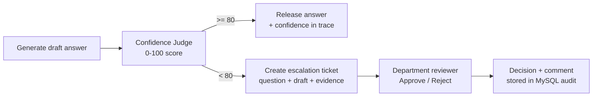

- **Confidence scoring node** — the judge evaluates whether every claim in the draft answer is directly supported by the retrieved evidence ("do not reward fluent writing — only evidence support").
- **Threshold** (default 80, configurable via `CONFIDENCE_THRESHOLD`) — below it, the answer is **never shown to the user**. The user receives a ticket reference instead.
- **Escalation tickets** — stored in MySQL with the question, draft answer, retrieved evidence chunks, confidence score, requesting user, and owning department.
- **Department reviewer model** — Security Admin reviews everything; other roles review escalations for departments they own. Guards prevent cross-department review (403) and double-reviewing (409).
- **Approval history** — every approve/reject decision records reviewer, comment, and timestamp in the audit trail.

---

## System Architecture

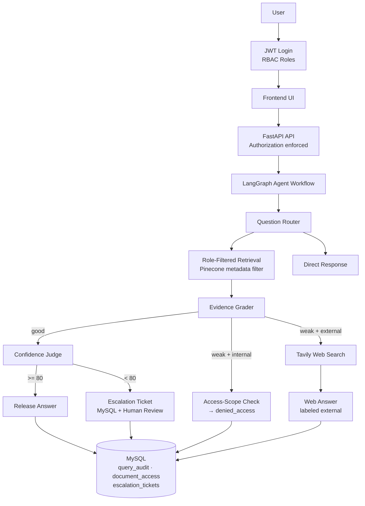

### Core workflow

1. The user logs in and receives a JWT with their roles/allowed departments.
2. The router classifies the question (KB vs. conversational).
3. Relevant documents are retrieved from Pinecone **filtered by the user's department access**.
4. The model grades the retrieved evidence.
5. If evidence is weak, an access-scope check decides between web fallback (external topics) and a denied-access response (internal topics the user cannot see).
6. If evidence is good, a draft answer is generated and **scored for confidence** by an LLM judge.
7. Confident answers are released; low-confidence answers are escalated to a human reviewer with evidence attached.
8. The system returns: answer, source used, confidence score, citations, access scope, and the reasoning trace — all logged to MySQL.

---

## API Surface

| Endpoint | Method | Auth | Purpose |
|---|---|---|---|
| `/api/auth/login` | POST | — | Obtain a JWT (demo users above) |
| `/api/auth/me` | GET | JWT | Current user's roles and department access |
| `/api/auth/roles` | GET | — | Describe the RBAC role model |
| `/api/health` | GET | — | Service health check |
| `/api/chat` | POST | JWT | Ask a question — role-filtered, confidence-scored, audited |
| `/api/ingest` | POST | JWT | Ingest a document with department security tagging |
| `/api/escalations` | GET | JWT | Reviewer queue (department-scoped) |
| `/api/escalations/mine` | GET | JWT | User's own ticket statuses |
| `/api/escalations/{ref}` | GET | JWT | Ticket detail with attached evidence |
| `/api/escalations/{ref}/review` | POST | JWT | Approve/reject with comment (reviewers only) |
| `/api/admin/audit` | GET | Admin | Full audit trail + document access + summary |

---

## Actual Output

Screenshots from a live session are below (stored in the `screenshots/` folder).

### 1. Login

JWT-based sign-in with RBAC roles — each demo user maps to a department scope.


### 2. Home Page

The chat UI after sign-in, showing the logged-in user, their roles, and allowed document departments.

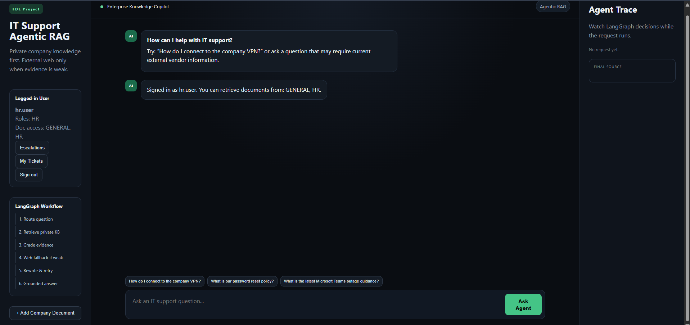

### 3. Happy Path — Confident Answer from Private KB

The user asks a question covered by their department's documents. The trace shows role-filtered retrieval, a good evidence grade, a confidence score above the threshold, and the answer released with citations.

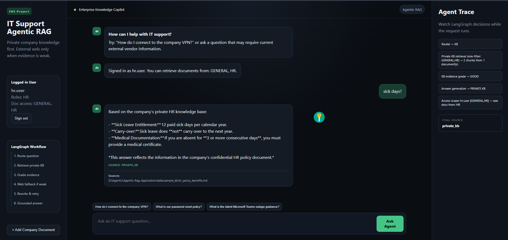

### 4. Unauthorized Access Blocked

A user asks about a department outside their role. The restricted documents are never retrieved (Pinecone-level filtering) and internal topics are not answered from the web — the agent responds with an access-scope message.

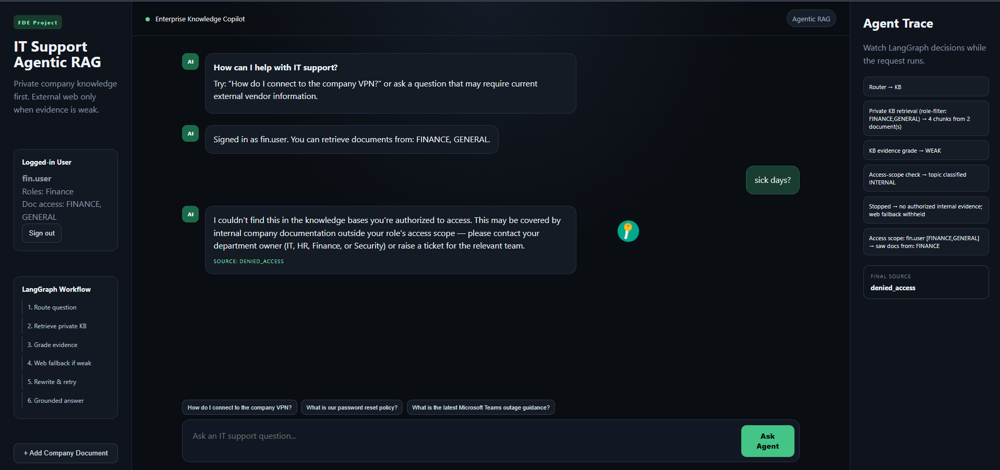

### 5 & 6. Web Search Fallback (External Topics)

For genuinely external questions (vendor/product/public information), the agent still falls back to Tavily — clearly labeled as external web information.

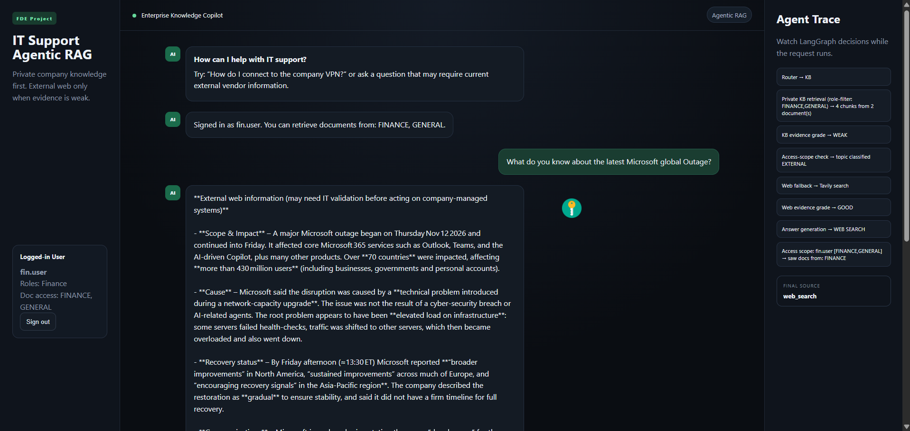


### 7. Low Confidence → Escalation

The confidence judge scored this answer below the 80 threshold, so the draft answer was **not** shown. Instead, an escalation ticket was created with the evidence attached, and the user received the ticket reference.

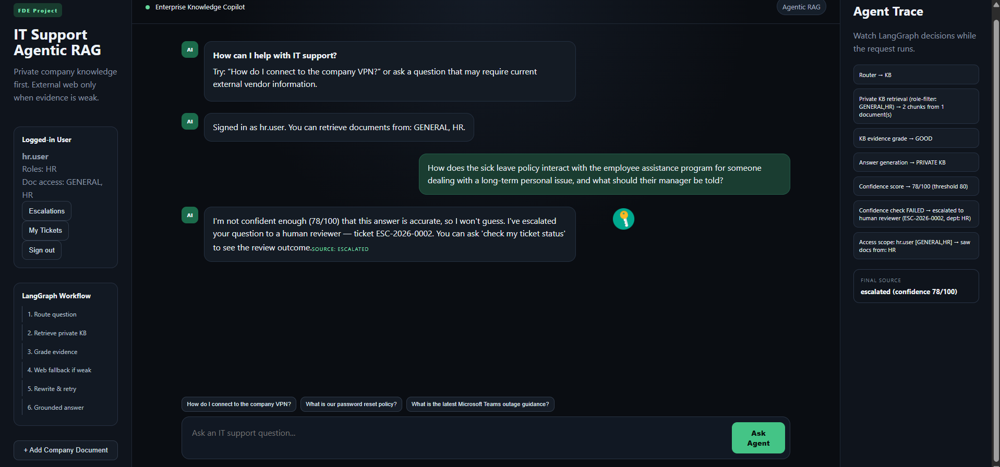

### 8. Human Review — Approval

The department reviewer opens the escalation queue, inspects the question, draft answer, and retrieved evidence side by side, then approves with a comment. The decision is recorded in the audit trail.

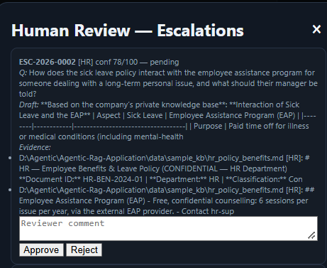

### 9. MySQL Tables

All audit and escalation data is persisted in the `agentic_rag` MySQL database.

**Overall tables:**

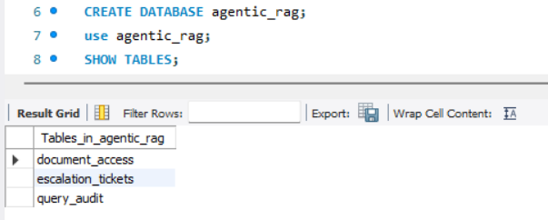

**`document_access`** — one row per document retrieved, by whom, under which role:

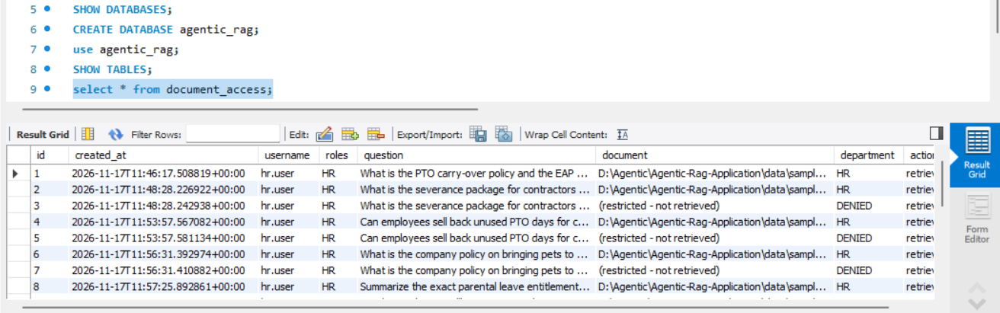

**`escalation_tickets`** — tickets with confidence, evidence, and review outcome:

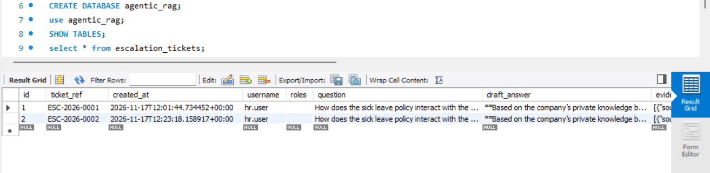

**`query_audit`** — every query with user, roles, source, and trace:

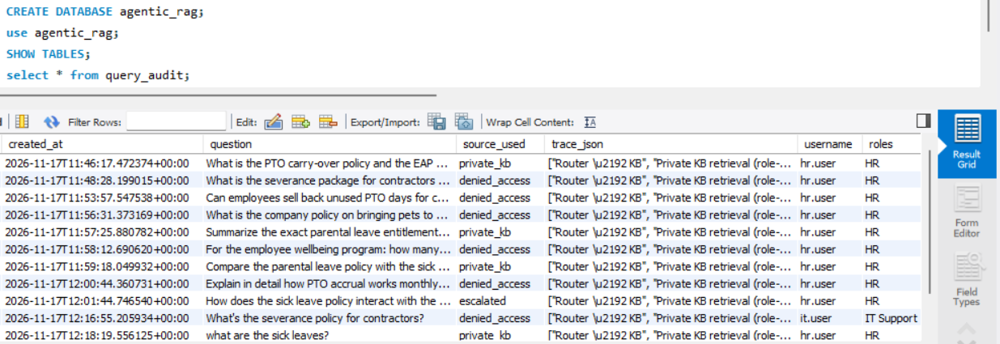

---

## Technical Challenges and Solutions

### 1. Routing ambiguous user queries

A major challenge in agentic RAG is deciding whether a request should be answered from a private knowledge base, a direct response, or a web search fallback.

**Solution:**
The project uses a LangGraph workflow with a router node that classifies the query. This keeps the system grounded and prevents unnecessary web searches for simple conversational inputs.

### 2. Low-quality or incomplete retrieval

Vector retrieval can surface weak context, especially when the query is vague or under-specified.

**Solution:**
The app uses evidence grading and query rewriting. If the initial retrieval is weak, the system attempts to rewrite the query and re-run retrieval — with the **authorization filter re-applied identically on every retry**, so rewrites can never widen access.

### 3. Preventing data leakage in a shared vector index

Storing HR policies, payroll data, and security runbooks in one Pinecone index means any unfiltered query could retrieve all of them.

**Solution:**
Document-level security enforced **at the vector DB level**: every chunk carries a `department` metadata tag, and retrieval passes a Pinecone metadata filter derived from the user's roles. A Finance user literally cannot retrieve HR vectors — regardless of how the question is phrased.

### 4. The web-fallback leak

A subtle but critical issue: when role-filtered retrieval returns nothing relevant, a naive workflow falls back to public web search — which can answer internal-policy questions with generic internet content, contradicting company policy.

**Solution:**
An access-scope classifier runs before web fallback. Internal-company questions with insufficient authorized evidence are answered with an access-scope redirect instead — never from the web. External topics still reach Tavily.

### 5. Preventing confident hallucinations

An LLM can produce a fluent, plausible answer that the retrieved documents do not actually support.

**Solution:**
An LLM-as-judge confidence node scores every private-KB answer strictly on evidence support. Answers below the 80% threshold are never shown — they become human-review tickets with the evidence attached.

### 6. Maintaining traceability and explainability

A black-box chatbot is hard to trust in enterprise contexts.

**Solution:**
The application logs the trace of each decision — routing path, retrieval counts, role-filter scope, evidence grade, confidence score, escalation references — and every query and document access is persisted in MySQL with the requesting user's identity.

### 7. Securing ingestion and document indexing

Allowing users to upload files to a production knowledge base introduces risk unless controlled.

**Solution:**
Ingestion requires authentication, and users can only tag documents into departments they belong to. Security Admin can tag any department. Every ingestion is audited.

---

## Results and Impact

This repository demonstrates a working prototype for **secure, accountable** agentic knowledge retrieval:

- FastAPI application server with JWT + RBAC authentication
- LangGraph orchestration: routing → filtered retrieval → grading → confidence scoring → escalation/generation
- Pinecone vector retrieval with document-level security filters
- Groq-based LLM routing, generation, grading, and confidence judging
- Human-in-the-loop review workflow with department-scoped reviewers
- MySQL persistence for audit trail and escalation tickets
- Tavily web fallback restricted to external topics
- Docker-based deployment support

---

## Getting Started

### Prerequisites

- Python 3.10+
- MySQL 8.0 running locally (database is auto-created)
- Docker (optional)
- API keys for:
  - Groq
  - Pinecone
  - Tavily

### 1. Clone the repository

```bash
git clone https://github.com/solutionundertaken95/Agentic-Rag-Application.git
cd Agentic-Rag-Application
```

### 2. Create a virtual environment

```bash
python -m venv venv
source venv/bin/activate
```

On Windows:

```bash
venv\Scripts\activate
```

### 3. Install dependencies

```bash
pip install -r requirements.txt
```

### 4. Configure environment variables

Create a `.env` file in the project root:

```env
GROQ_API_KEY=your_groq_key
TAVILY_API_KEY=your_tavily_key
PINECONE_API_KEY=your_pinecone_key
PINECONE_INDEX_NAME=fde-it-support-rag
PINECONE_NAMESPACE=company-it-kb
JWT_SECRET_KEY=change-me-jwt-secret
CONFIDENCE_THRESHOLD=80

# MySQL (audit trail + escalation tickets; database auto-created)
MYSQL_HOST=127.0.0.1
MYSQL_PORT=3306
MYSQL_USER=root
MYSQL_PASSWORD=your_mysql_password
MYSQL_DATABASE=agentic_rag
APP_ENV=development
```

### 5. Ingest sample data

Indexes the sample KB with department security tags (IT / HR / FINANCE / SECURITY):

```bash
python ingest_sample_kb.py
```

### 6. Run the app

```bash
python run.py
```

Then open:

- Frontend: `http://127.0.0.1:8080`
- API docs: `http://127.0.0.1:8080/docs`
- Sign in with a demo user (see the table in [Feature 1](#feature-1--authorization-aware-rag-rbac--document-level-security))

### 7. Run the app in Docker

```bash
docker build -t agentic-rag-app .
docker run -p 8080:8080 --env-file .env agentic-rag-app
```

### 8. Try the demo flows

- **Happy path:** as `hr.user`, ask *"How many paid sick days do employees get?"* → confident answer from the HR doc.
- **Access blocked:** as `fin.user`, ask the same → the HR document is invisible; internal topics are not answered from the web.
- **Escalation:** as `hr.user`, ask *"How does the sick leave policy interact with the employee assistance program, and what should their manager be told?"* → low confidence → ticket created.
- **Human review:** sign in as `secadmin` (or `hr.user` as department owner) → Escalations panel → inspect evidence → Approve/Reject.
- **Audit:** as `secadmin`, open the Audit Trail panel — every query, document access, and review decision is there.

---

## Future Scope

- **Action Agent (RAG + tool calling)** — read-only tools (ticket status, incident search) immediately; mutating tools (create ServiceNow ticket, reset test account) gated through the human-approval workflow
- **Retrieval evaluation & hallucination detection** — automated RAGAS/DeepEval pipeline measuring answer faithfulness, context precision, and hallucination rates (confidence scores already logged as the dataset)
- Re-deliver approved escalation answers back to the requesting user automatically
- Improve agent memory and session continuity
- Add support for more enterprise document types
- Rate limiting, refresh tokens, and a real user-management endpoint to replace seeded demo users
- Model fallback strategies for LLM resilience
- Dashboards for monitoring cost, latency, confidence trends, and escalation rates

---

## License

No license is currently specified in this repository. If this project is intended for public reuse or distribution, adding an explicit license is recommended.
