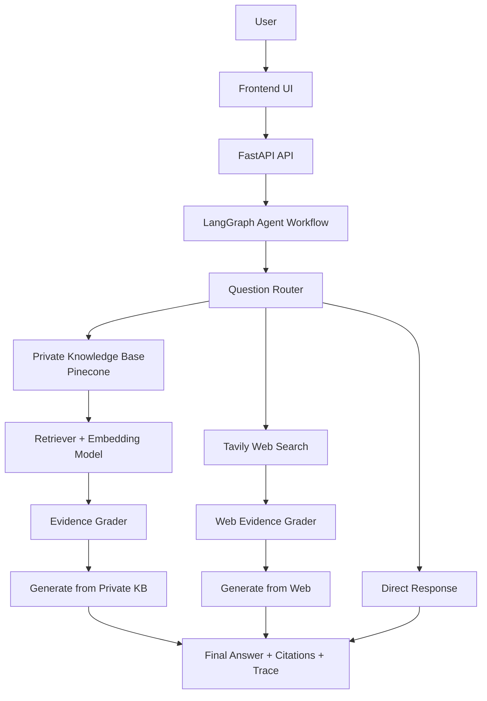

# 🤖 Enterprise IT Support Agentic RAG Copilot

[](https://www.python.org/)
[](https://fastapi.tiangolo.com/)
[](https://www.langchain.com/langgraph)
[](https://www.pinecone.io/)
[](https://groq.com/)
[](https://tavily.com/)
[](https://www.docker.com/)

An intelligent, agentic retrieval-augmented generation (RAG) application built in Python for enterprise knowledge assistance. The project combines FastAPI, LangGraph, Pinecone, and LLM-based reasoning to route user questions, retrieve relevant context from a private knowledge base, and fall back to web search when needed.

This repository is designed as a proof-of-concept for building a grounded, explainable AI assistant that can answer questions from both private documents and external web sources while exposing a clear reasoning trace.

## Contents

- [What We Built](#what-we-built)
- [System Architecture](#system-architecture)
- [Technical Challenges and Solutions](#technical-challenges-and-solutions)
- [Results and Impact](#results-and-impact)
- [Getting Started](#getting-started)
- [Future Scope](#future-scope)

---

## What We Built

This project implements a full-stack agentic RAG workflow with:

- A FastAPI backend and web UI
- LangGraph-powered agent orchestration
- Retrieval from a Pinecone vector database
- LLM-based routing, evidence grading, and answer generation
- Web fallback using Tavily
- Document ingestion for user-uploaded knowledge files
- Audit logging for traceability

The application is designed around a real enterprise support use case: answering user queries using company knowledge while falling back to external search if the internal knowledge base is weak or missing.

### Current repository composition

The repository is primarily Python-based:

- Python: 73.9%
- HTML: 12.1%
- JavaScript: 12.1%
- Dockerfile: 1.9%

The implementation is organized into application layers:

- `app/api` — API routes for health checks, chat, and ingestion
- `app/core` — configuration, settings, and logging
- `app/rag` — vector retrieval, graph workflow, and orchestration logic
- `app/services` — ingestion, audit, and supporting services
- `templates/` and `static/` — frontend UI assets
- `data/` and `uploads/` — sample knowledge base and uploaded user content

---

## System Architecture



### Core workflow

The application follows a retrieval and reasoning loop:

1. The user submits a question through the API or UI.
2. The router decides whether the question is:
   - a knowledge-base question
   - a direct conversational question
   - or a case requiring fallback search
3. Relevant documents are retrieved from the Pinecone vector index.
4. The model grades the retrieved evidence for quality.
5. If the evidence is strong, the assistant answers from the private KB.
6. If the evidence is weak, the app triggers a Tavily search.
7. The answer is generated using the best available evidence.
8. The system returns:
   - answer text
   - source used
   - citations
   - rewritten query (if applicable)
   - trace of the reasoning path

### API surface

The repository exposes the following core endpoints:

| Endpoint | Method | Purpose |
|---|---|---|
| `/api/health` | GET | Service health check |
| `/api/chat` | POST | Submit a question and receive a grounded answer |
| `/api/ingest` | POST | Upload and ingest a document into the KB |

The app also includes a UI served by FastAPI and Jinja2 templates.

---

## Technical Challenges and Solutions

### 1. Routing ambiguous user queries

A major challenge in agentic RAG is deciding whether a request should be answered from a private knowledge base, a direct response, or a web search fallback.

**Solution:**  
The project uses a LangGraph workflow with a router node that classifies the query. This keeps the system grounded and prevents unnecessary web searches for simple conversational inputs.

### 2. Low-quality or incomplete retrieval

Vector retrieval can surface weak context, especially when the query is vague or under-specified.

**Solution:**  
The app uses evidence grading and query rewriting. If the initial retrieval is weak, the system attempts to rewrite the query and re-run retrieval. This creates a self-correction loop rather than a single-pass answer.

### 3. Mixing private and public knowledge safely

For enterprise use, answers must be grounded in internal documentation whenever possible. Public web data should be treated as secondary and clearly labeled.

**Solution:**  
The workflow prioritizes the private knowledge base, then evaluates whether it is strong enough to answer. If not, it uses Tavily search and clearly labels the answer as web-based or externally sourced.

### 4. Maintaining traceability and explainability

A black-box chatbot is hard to trust in enterprise contexts.

**Solution:**  
The application logs the trace of each decision, including:
- routing path
- retrieval counts
- evidence grade
- query rewrite steps
- source used for final answer

This makes the system easier to audit and debug.

### 5. Securing ingestion and document indexing

Allowing users to upload files to a production knowledge base introduces risk unless controlled.

**Solution:**  
The project includes an admin-only ingestion flow using an `X-Admin-Key` header, which protects the document indexing endpoint.

---

## Results and Impact

This repository demonstrates a working prototype for agentic knowledge retrieval with the following implemented capabilities:

- FastAPI-based application server
- LangGraph orchestration flow
- Pinecone-based vector retrieval
- Groq-based LLM routing and generation
- Tavily web fallback
- Document upload and indexing
- Trace output for reasoning steps
- Docker-based deployment support

### Quantifiable project facts

From the repository structure and setup:

- 1 FastAPI application entrypoint
- 4 main application layers: `api`, `core`, `rag`, `services`
- 1 Dockerfile for containerized deployment
- 1 main ingestion script: `ingest_sample_kb.py`
- 1 primary run entrypoint: `run.py`
- 1 vector database integration via Pinecone
- 1 external search integration via Tavily
- 1 admin-protected ingestion route for knowledge updates

This is best characterized as a functional prototype demonstrating the viability of agentic RAG orchestration rather than a production-scale enterprise deployment. No large-scale benchmark or throughput data is included in the repository.

---

## Getting Started

### Prerequisites

- Python 3.10+
- Docker (optional)
- API keys for:
  - Groq
  - Pinecone
  - Tavily
  - OpenAI (optional, depending on the configured model path)

### 1. Clone the repository

```bash
git clone https://github.com/solutionundertaken95/Agentic-Rag-Application.git
cd Agentic-Rag-Application
```

### 2. Create a virtual environment

```bash
python -m venv venv
source venv/bin/activate
```

On Windows:

```bash
venv\Scripts\activate
```

### 3. Install dependencies

```bash
pip install -r requirements.txt
```

### 4. Configure environment variables

Create a `.env` file in the project root:

```env
GROQ_API_KEY=your_groq_key
TAVILY_API_KEY=your_tavily_key
PINECONE_API_KEY=your_pinecone_key
PINECONE_INDEX_NAME=fde-it-support-rag
PINECONE_NAMESPACE=company-it-kb
ADMIN_API_KEY=change-me
APP_ENV=development
```

### 5. Ingest sample data

```bash
python ingest_sample_kb.py
```

### 6. Run the app

```bash
python run.py
```

Then open:

- Frontend: `http://127.0.0.1:8000`
- API docs: `http://127.0.0.1:8000/docs`

### 7. Run the app in Docker

```bash
docker build -t agentic-rag-app .
docker run -p 8000:8000 --env-file .env agentic-rag-app
```

---

## Future Scope

- Add multi-document metadata filtering for more precise retrieval
- Improve agent memory and session continuity
- Add support for more enterprise document types
- Add a persistent database for audit logs and user activity
- Add rate limiting and auth for production deployment
- Introduce model fallback strategies for LLM resilience
- Add evaluate/test pipelines for answer quality and retrieval precision
- Expand to multi-agent specialization (retrieval agent, reasoning agent, validation agent)
- Add dashboards for monitoring cost, latency, and answer quality
- Generalize from IT support to broader enterprise knowledge assistants

---

## License

No license is currently specified in this repository. If this project is intended for public reuse or distribution, adding an explicit license is recommended.
